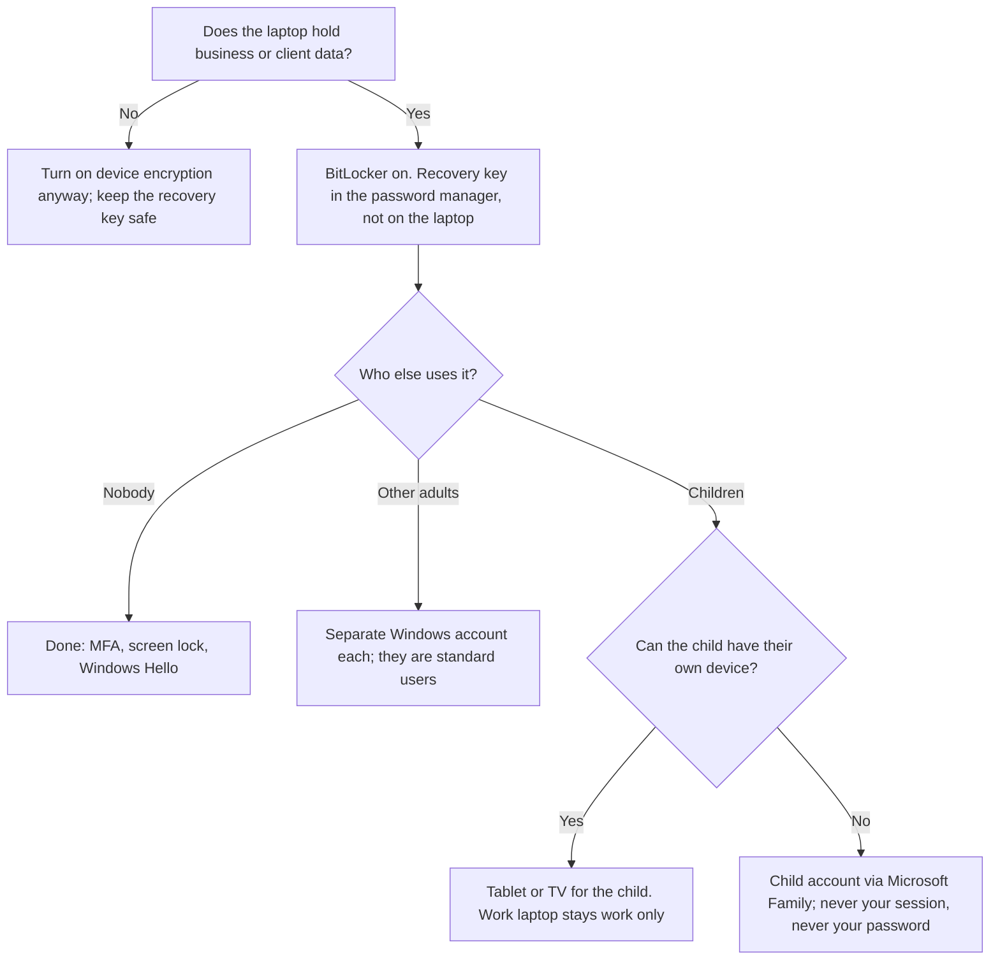

# To BitLocker or not to BitLocker

Status: round 1 drafted 2026-11-05. The "where we landed" column is proposed until Hakim confirms it.

## The question

Should a laptop be encrypted with BitLocker, and does the answer change when the laptop is used by one person, shared by a family, or a work laptop the children also use?

## Why it matters

Laptops get lost, stolen and borrowed. An unencrypted drive can be pulled out and read on any other computer. But encryption is not the whole story: most real harm on family and small-business laptops does not come from a stranger with a screwdriver. It comes from someone already inside the unlocked session, and very often that someone is three years old.

## The scenario

A founder's laptop holds client files, email, banking and the company's cloud accounts. It is locked down properly: long password, MFA, short screen lock. On a Saturday morning a three-year-old wants Ms Rachel. The tablet is flat. The parent, tired of typing a 20-character password every time the screen locks, says the password out loud and hands the laptop over. From that moment the child is inside the parent's session: Gmail one tab away, client folders on the desktop, the bank's saved login in the browser. BitLocker is switched on and did nothing, because nobody stole the laptop. It was handed over.

## What BitLocker does and does not do

| BitLocker protects against | BitLocker does not protect against |
| --- | --- |
| A lost or stolen laptop that is switched off or locked | Anyone using the laptop while you are signed in |
| Someone removing the drive and reading it on another computer | Malware, phishing or a stolen cloud password |
| A repair shop or recycler reading old data | Family members with their own account on the same laptop reading shared folders |
| Data on a laptop sold or disposed of | A password said out loud or written on a sticky note |

Encryption protects the device from strangers. Separate accounts protect people from each other. Habits protect the session.

## Three laptops

| | Single-user business laptop | Shared family laptop | Work laptop the children also use |
| --- | --- | --- | --- |
| Who uses it | One adult | Several family members | One adult officially; children in practice |
| Main risk | Loss or theft | People seeing or changing each other's things | A child inside the work session: sends, deletes, purchases, client data on screen |
| BitLocker | Yes, always | Yes: protects everyone's data if stolen | Yes, but it does not touch the main risk |
| What actually controls the main risk | MFA, screen lock, recovery key held safely | A separate Windows account for each person; adults as administrators, everyone else a standard user; children on a Microsoft Family child account | Do not share the work laptop. Give the child their own device, or at minimum their own child account |
| What a client's questionnaire expects | "Used only by authorised staff" is true | Client data should not be on it | "Used only by authorised staff" is false; answering yes is a misstatement |
| Recovery key | In the password manager or company account | In the account of the adult who owns the device | In the company's records, not the family's |

## Decision flow

## Thrashing it out

Hakim takes a position, Polly, my AI assistant, challenges it, and we record where we landed. Nothing here is final.

| # | Position (Hakim) | Challenge (Polly) | Where we landed (proposed) |
| --- | --- | --- | --- |
| 1 | To BitLocker or not? | On new Windows 11 laptops the decision is usually already made: since version 24H2, a clean install signed in with a Microsoft account turns device encryption on by default, Home edition included. Many people are encrypted and do not know where their recovery key is | Yes on any laptop with business or client data. The real decision is custody of the recovery key: in the password manager or the company account, never only on the laptop. Check with `manage-bde -status C:` rather than assuming |
| 2 | A single-user laptop, a shared laptop and a work laptop the kids use are different problems | Agreed, and BitLocker is the same in all three. What changes is who is inside the session once it is unlocked | Encryption protects the device from strangers; accounts protect people from each other. A work laptop the children use cannot honestly be described to a client as "used only by authorised staff" |
| 3 | Lock a laptop down too hard and the password just gets handed over, so your three-year-old can watch Ms Rachel | This is security fatigue, which NIST documented in 2016: when security asks for more decisions than people can manage, they choose the easiest option and stop following the rules. The control did not fail because the parent was careless; it failed because it left no legitimate path for the child | Every restriction needs a legitimate path for the people it inconveniences. Give the toddler a tablet, a TV, or a child account with Ms Rachel one tap away, so the password never has to be shared. Test: if a control produces a workaround within a week, the control is wrong, not the person |
| 4 | (Raised by Polly) Should the laptop also ask for a PIN before Windows starts? | A pre-boot PIN stops some attacks on a stolen laptop, but adds one more thing to type, and the toddler problem gets worse, not better | Proposed: a pre-boot PIN for consultants who travel with client data; not for family laptops. Windows Hello (face or fingerprint) for everyday sign-in, so the long password is rarely typed and never needs saying out loud |

## The costs of BitLocker, honestly

- **Recovery key prompts.** After some firmware or BIOS updates, hardware repairs or motherboard changes, Windows asks for the 48-digit recovery key. Without it, the data is gone.
- **Repair shop friction.** Technicians may need the key; give it for the visit, then change it.
- **Performance.** Software encryption can slow some SSDs; most modern laptops encrypt in hardware and the difference is small [likely, varies by model].
- **False comfort.** "We use BitLocker" is often said as if it answers every device question. It answers one.

## Controls checklist

- [ ] BitLocker or device encryption on, confirmed with `manage-bde -status C:` and a screenshot
- [ ] Recovery key in the password manager or company account, not on the laptop
- [ ] Windows Hello for everyday sign-in, so the password is rarely typed
- [ ] One Windows account per person; only adults who own the device are administrators
- [ ] Children on a Microsoft Family child account, or their own device
- [ ] Work laptops used only by the person they are issued to, as the client questionnaire will ask
- [ ] Any control that produced a workaround reviewed within a week

## Open questions

- What is the cheapest child device that gives a three-year-old Ms Rachel without giving them anything else?
- How should a firm word its device policy so a parent working from home can follow it on a Saturday morning?
- Does a small firm's cyber insurance cover a loss caused by a family member using a work laptop?

## Sources

- [Microsoft confirms Windows 11 24H2 turns on device encryption by default (Windows Latest, May 2024)](https://windowslatest.com/2024/05/08/microsoft-confirms-windows-11-24h2-turns-on-device-encryption-by-default)
- [Microsoft is enabling BitLocker device encryption by default on Windows 11 (Techlore summary of The Verge)](https://discuss.techlore.tech/t/microsoft-is-enabling-bitlocker-device-encryption-by-default-on-windows-11/9639)
- [Security fatigue can cause computer users to feel hopeless and act recklessly (NIST, 2016)](https://www.nist.gov/news-events/news/2016/10/security-fatigue-can-cause-computer-users-feel-hopeless-and-act-recklessly)
- [Windows 11 parental controls (Internet Matters)](https://internetmatters.org/parental-controls/smartphones-and-other-devices/windows-11-parental-controls)
- [BitLocker overview (Microsoft)](https://learn.microsoft.com/en-us/windows/security/operating-system-security/data-protection/bitlocker/)
